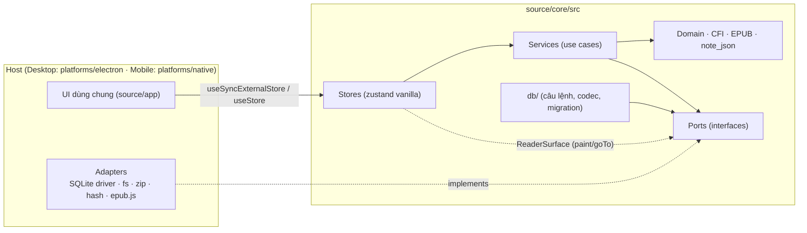

# Core (`source/core`)

Lõi nghiệp vụ **độc lập nền tảng** của reading-book-app (trước spec 009 là `source/apps/book-reader-sdk` +
`source/packages/config`; nội dung trang này lấy từ README cũ của SDK, cập nhật theo bố cục một project). Kiến trúc
tổng thể: `docs/software/SDS.md` §2.7, §2.11; luật phụ thuộc: `specs/009-single-project-monorepo/contracts/dependency-rules.md`.

Kiểu dữ liệu domain, xử lý CFI, phân tích gói EPUB, logic annotation (highlight / underline / strikethrough / text
note / bookmark), luật TXT / Markdown / audio / typewriter / annotation transfer, câu lệnh SQL + codec dùng chung cho
hai host, và các **zustand store** (vanilla). Mọi thao tác I/O (SQLite, file system, giải nén ZIP, hash, engine render)
đều do **host inject**.

- **Không có bản build**: hai app dùng thẳng mã nguồn qua alias `@core` → `source/core/src/index.ts`, `@core/*` →
  `source/core/src/*` (ví dụ `@core/config`). Khai báo alias ở `tsconfig*.json`, `vite.config.ts`,
  `vite.native.config.ts`, `vitest.config.ts` của Mobile — giữ đồng bộ.
- Core biên dịch với `tsconfig.core.json` (`lib: ES2022`, `types: []`) → dùng **biến toàn cục** Node/DOM (`fs`,
  `window`, `Buffer`, `process`…) trong `src/` là **lỗi compile** (R1). **Import package** (`better-sqlite3`, `react`,
  `epubjs`…) thì tsconfig không chặn được: `npm run check:boundaries` kiểm — chỉ cho phép đường dẫn tương đối bên trong
  `src` và `zustand/vanilla` (R2), và core không bao giờ import app (R3, R5).
- `Location.toString()`, `locatorRef`, `last_read_location` khớp dữ liệu desktop. Hình dạng dữ liệu lưu trữ được chốt
  bằng contract fixtures ở `tests/contracts/`.

## Cấu trúc

```
source/core/
├── package.json            chỉ "type": "module" (để spike chạy TS của core dưới dạng ES module); không dependency
├── src/
│   ├── index.ts            public API (alias @core)
│   ├── core/               createBookReaderSdk (composition root), errors, event bus, defaults, runtime
│   ├── ports/              INTERFACE host implement: storage, file-system, archive, platform, reader-surface, tts, translation
│   ├── domain/ domain-ports/   Book, Location, MarkupAnnotation/Bookmark, ReadingSession, prefs; port domain (AiProvider…)
│   ├── cfi/                chuỗi CFI, parse step/offset, so sánh thứ tự tài liệu, codec
│   ├── annotations/        locator pack/unpack, màu, citation, undo history, filter/sort/group
│   ├── app-models/         luật thuần dùng bởi renderer và Main: highlight, bookmark, PDF annotation, embedded sync, two-way…
│   ├── epub/ txt/ md/ audio/ typewriter/ transcription/ attachments/ annotation-transfer/ ink/   luật theo tính năng
│   ├── persistence/        parser cột JSON của `books` + pack/unpack `last_read_location`
│   ├── db/                 driver.ts (SyncSqlDriver / AsyncSqlDriver), câu lệnh + codec: library/ overlay/ txt/ audio/
│   │                       transcript/; desktop/migrations (001–030), mobile/migrations, migrations.ts (lập kế hoạch)
│   ├── config/             formats, theme tokens, feature flags, OAuth config (secrets không bao giờ vào bundle)
│   ├── text/               HTML → đoạn văn, chunk 400–500 từ (FTS/RAG), Word Count, chia câu đọc to
│   ├── pagination/ viewport/ search/ readers/   đếm trang EPUB, toán zoom / popover, luật tìm kiếm, registry format
│   ├── services/           use case: library (import/dedupe/rollback), annotations, bookmarks, session
│   ├── stores/             zustand vanilla: library, annotations, bookmarks, session
│   └── testing/            adapter in-memory (spec thực thi được của các port)
└── tests/                  vitest — unit test (cùng cấu trúc src/), integration/reader-flow.test.ts, contracts/
```

Lệnh (từ gốc repo): `npm run sdk:typecheck`, `npm run sdk:typecheck:tests`, `npm run sdk:test` (một file:
`cd source/core && npx vitest run tests/text/chunk-text.test.ts`), `npm run sdk:test:watch`.

## Kiến trúc



Luồng phụ thuộc chỉ đi **vào trong**: stores → services → domain/ports. Core không biết adapter nào đang chạy.

### Driver SQL (spec 009)

Core **sở hữu câu SQL và codec** dùng chung (`src/db/*/statements.ts`, `codec.ts`); mỗi host chỉ đưa driver qua port:

| Port | Host | Adapter |
|---|---|---|
| `SyncSqlDriver` (`run` / `all` / `get` / `transaction(work, mode)` — `work` đồng bộ, không `await`) | Desktop Main | `platforms/electron/persistence/sql-driver.ts` (better-sqlite3) |
| `AsyncSqlDriver` (`run` / `all` / `transaction(statements)`) | Mobile WebView | `platforms/native/bridge/host-sql-driver.ts` (dịch vụ `sql.*` của host, expo-sqlite) |

Luật R6 (`check:boundaries`) bắt hai adapter này implement đúng port. Hợp đồng: `specs/009-single-project-monorepo/contracts/sql-drivers.md`.

### Các port khác (Dependency Injection của `createBookReaderSdk`)

| Port | Bắt buộc | Mặc định | Ví dụ implementation |
|---|---|---|---|
| `storage.library` / `annotations` / `bookmarks` / `sessions` | ✔ | — | SQLite, IPC, in-memory (`createInMemoryStorage`) |
| `fileSystem` | khi `importFile` | — | `node:fs`, `expo-file-system` |
| `archive` | không (thiếu → metadata theo tên file) | — | JSZip, fflate |
| `hash` | khi `importFile` | WebCrypto `crypto.subtle` | `node:crypto`, `expo-crypto` |
| `ids` | nếu nền tảng không có `crypto` | `crypto.randomUUID` | `expo-crypto` |
| `clock`, `scheduler`, `logger` | không | `Date`, `setTimeout`, `console` | fake timers trong test |
| `ReaderSurface` (gắn lúc runtime) | không | — | epub.js handle, WebView bridge |
| `TtsEngine` (host tự dùng cho đọc to) | không | — | Web Speech (desktop), `expo-speech` |

Adapter được **kiểm tra shape lúc runtime** (`ADAPTER_INVALID: storage.annotations is missing method(s): saveMarkup`).
Port optional chỉ bị đòi khi thao tác cần nó chạy (`ADAPTER_MISSING`).

## Khởi tạo (`createBookReaderSdk`)

```ts
import { CfiLocation, createBookReaderSdk, createInMemoryStorage, createStoreHook } from '@core'

const sdk = createBookReaderSdk({
  adapters: { storage: createInMemoryStorage(), fileSystem, archive: jszipArchive },
  options: { autosaveDelayMs: 1000, undoLimit: 50 },
})

sdk.events.on('error', ({ scope, operation, error }) => toast(`${scope}.${operation}: ${error.code}`))

await sdk.openBook(bookId)
const detach = sdk.attachSurface(createEpubSurface(() => epubHandleRef.current, (cfi) => new CfiLocation(cfi)))

// Annotation — cập nhật lạc quan, lưu nền, tự rollback + phát event `error` khi lỗi
const { create, update, undo } = sdk.stores.annotations.getState()
const h = await create({ kind: 'highlight', location: new CfiLocation(sel.cfiRange), chapterIndex: nav.spineIndex, selectionText: { highlight: sel.text } })
await update(h!.id, { kind: 'strikethrough', note: 'xem lại' })
undo()

// React — core không import React
const useAnnotations = createStoreHook(sdk.stores.annotations, React.useSyncExternalStore)

await sdk.closeBook()   // flush session, reset store theo sách
await sdk.dispose()     // mọi lời gọi sau đó ném SdkError('DISPOSED')
```

### Hợp đồng lỗi

- Lỗi **lập trình** (input sai, chưa mở sách, adapter thiếu) → `throw SdkError` / promise reject.
- Lỗi **lưu trữ** trong action của store → state được rollback, phát event `error`, promise resolve `null` / `false` /
  `{ status: 'failed' }`.
- Kiểm tra lỗi bằng `isSdkError(e)` + `e.code`, **không** dùng `instanceof`.

## Host thật dùng core thế nào (hiện trạng)

Cả hai app **không** dùng `createBookReaderSdk`, `sdk.services.*` hay `sdk.stores`: chúng import thẳng các module thuần
qua `@core`. API `createBookReaderSdk` vẫn chạy (test `tests/integration/reader-flow.test.ts`) nhưng chưa app nào áp dụng.

| Host | Dùng gì từ core | Lưu trữ |
|---|---|---|
| UI dùng chung (`source/app`) | `app-models/*`, `Location`/CFI, `txt/`, `audio/`, `annotation-transfer/`, `attachments/`, `typewriter/`, prefs mặc định, `config/` | Qua adapter `api` (`@app/platforms/api`) |
| Desktop Main (`source/app/platforms/electron`) | Cùng các luật thuần ở trên (kiểm tra lại payload, lập kế hoạch sync / import), `db/` qua `SyncSqlDriver`, migration `db/desktop/migrations` | better-sqlite3, `persistence/sqlite-*-store.ts` |
| Mobile WebView (`source/app/platforms/native`: `bridge/`, `stores/`, `db/`) | Chính UI dùng chung + trong bridge / store: `Book`, `parseDocumentFormat`, `readEpubImportMetadata`, luật TXT và Markdown, parse locator PDF / Markdown, `db/` qua `AsyncSqlDriver` | `stores/*` trên SQLite của host, test với contract fixtures |
| Mobile host React Native (`platforms/native/{routes,host}`) | Không import core ở bản đầu (OD-1) | `expo-sqlite`, `expo-file-system` |

## Giới hạn hiện tại

- Parser XML của EPUB chỉ quét các phần tử phẳng cần cho metadata (không dựng cây DOM); đủ cho container/OPF, không
  dùng cho XHTML nội dung. Phân giải CFI → DOM `Range` vẫn thuộc renderer.
- Schema Desktop và Mobile tách riêng (OD-3); chỉ câu lệnh / codec dùng chung, migration riêng mỗi host.
